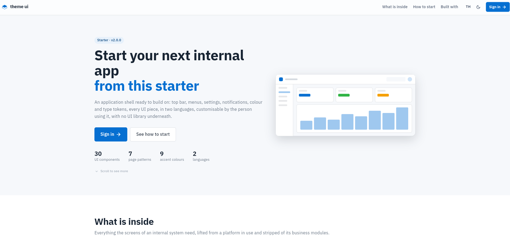

# Theme UI

A Flutter theme page: the app shell, design tokens and UI kit, ready to start a project from.

Live demo: https://littihai.github.io/Theme-UI/ · Thai: [README.th.md](README.th.md)

[](https://littihai.github.io/Theme-UI/)

```powershell
flutter pub get
flutter run -d chrome        # sample accounts: admin / demo, staff / demo
```

Guides: [docs/theme-guide.md](docs/theme-guide.md) · [docs/decisions](docs/decisions) · the Manual page inside the app

## License

[MIT](LICENSE)
