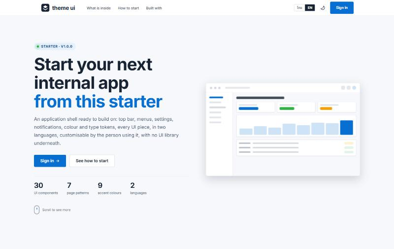

# Theme UI

แม่แบบ React + TypeScript สำหรับระบบภายในองค์กร: เปลือกของแอป (shell), design system และชุดชิ้นส่วน UI ของแพลตฟอร์ม
[Lotline](https://github.com/Littihai/TMCL-PR) ที่แยกออกมาเพื่อให้โปรเจกต์ถัดไปเริ่มจากตรงนี้ได้เลย
หน้าจอไทย/อังกฤษ ไม่มี backend: การเข้าสู่ระบบเป็นแบบจำลองในหน่วยความจำ และทุกหน้าแสดงข้อมูลตัวอย่าง

ดูตัวอย่างสด: **https://littihai.github.io/Theme-UI/** (deploy จาก `main` โดย `.github/workflows/pages.yml`) · English version: [README.md](README.md)

[](https://littihai.github.io/Theme-UI/)

## มีอะไรให้บ้าง

| ส่วน | สิ่งที่ได้ |
|---|---|
| **Shell** | แถบบนพร้อมเมนูใหญ่แบบ Linear หรือแถบข้าง / แถบไอคอน (ผู้ใช้เลือกเอง); เมนูมือถือ; เมนูบัญชี; กระดิ่งแจ้งเตือน; Ctrl-K palette; หน้าต่าง Settings ที่เป็น route (`/settings/<section>`); ส่วนท้าย |
| **หน้าตา** | สว่าง / มืด / ตามระบบ (ตอนสลับ สีใหม่ขยายเป็นวงกลมจากปุ่ม ด้วย View Transitions API); สีหลัก 9 สี; ฟอนต์ 4 แบบ (อ่านไทยได้ทุกแบบ); โทนเทา 5 แบบ; มุมโค้ง; ความกว้างหน้า; แถบติดหน้าจอ; ขอบแนบหรือลอย; ขนาดตัวอักษร S/M/L; คอนทราสต์สูง; ลดการเคลื่อนไหว ทั้งหมดจำต่อเครื่องและใส่ก่อนวาดเฟรมแรก (`public/theme-init.js`) |
| **ชุด UI** | Button, Badge, Switch, Tabs, Select (ค้นหาได้ จัดกลุ่ม มีโทน), DateRange, Field / FormAlert / Dialog, Pager, หัวตารางเรียงได้, ส่งออก CSV, BulkBar, ActiveFilters, Breadcrumb, PageHeader, StageCard / ActionBar, Timeline, Skeleton, EmptyState, ErrorState, InlineError (ตามชนิดความล้มเหลว), ComingSoon, Toast, ไดอะล็อกยืนยัน/ขอเหตุผล, กราฟ SVG วาดเอง |
| **ท่อส่ง** | ซอง `ApiResponse<T>` + fetch client ที่ต่ออายุ token เอง ตรวจ offline/timeout และแปลงความล้มเหลวเป็นข้อความอ่านได้; provider ของ auth และสิทธิ์ (`usePermissions().can("APP.MODULE.ACTION")`, `<RequireCan>`); พจนานุกรมสองภาษาพร้อมสคริปต์ตรวจใน CI; ไอคอน Octicons เท่านั้น |
| **ก่อนเข้าสู่ระบบ** | Landing page (hero, bento ว่ามีอะไรบ้าง, 4 ขั้นเริ่มต้น, ทางเข้า) พร้อมเอฟเฟกต์เลื่อนเผย การ์ดเอียงตามเมาส์ และ header แบบกระจก; หน้า Login 2 แบบ (`BRAND.loginLayout`: แผงแบรนด์สีเข้มข้างการ์ด หรือการ์ดกลางจอ) |
| **หน้าตัวอย่าง** | Home (ภาพรวม), Components (ทุกชิ้นส่วน), Tables (หน้ารายการครบชุด), Charts, Document (ขั้นตอน + อนุมัติ), Manual (คู่มือนี้ในแอป), Admin (หน้าที่ต้องมีสิทธิ์) |

## รัน

ต้องมี Node.js 22 ขึ้นไป

```powershell
npm ci
npm run dev          # http://localhost:5173
```

เข้าสู่ระบบด้วยบัญชีตัวอย่าง: `admin` / `demo` (ทุกสิทธิ์) หรือ `staff` / `demo` (มีแค่ DEMO.VIEW) ทั้งสองเป็นบัญชีสมมติ
อยู่ใน `src/services/authService.ts`

```powershell
npx tsc --noEmit     # ตรวจ type
npm run check:i18n   # ทุก key ที่โค้ดเรียกต้องมีใน src/i18n (และรายงาน key ที่ไม่ได้ใช้)
npm run build        # ตรวจ type + build ลง dist/
```

## เริ่มโปรเจกต์ใหม่จากแม่แบบนี้

1. สร้าง repository จากอันนี้ (Use this template หรือ clone แล้วเปลี่ยน remote)
2. เปลี่ยนชื่อผลิตภัณฑ์ใน `src/constants/brand.ts` และเปลี่ยนโลโก้ใน `src/components/ui/AppLogo.tsx` กับ `public/favicon.svg`
   (เพิ่ม PNG 180×180 สำหรับหน้าจอหลัก iOS ถ้าต้องการ)
3. แทนที่ `src/services/authService.ts` ด้วยการเรียก API จริง (คงฟังก์ชัน `login`, `verify`, `logout`, `forgetSession` ไว้)
   `AuthProvider` ไม่ต้องแก้ ส่วน `services/apiClient.ts` จัดการ token, การต่ออายุ และซองความล้มเหลวให้แล้ว
4. เพิ่มโมดูล: `src/modules/<name>/` (หน้า), `src/services/<name>Service.ts` (ที่เดียวที่เรียก API),
   route ใน `src/app/routes.tsx`, รายการเมนูใน `src/constants/nav.ts` และ `src/i18n/dict.<name>.ts`
5. ลบโมดูล showcase (`src/modules/showcase` และ key `demo.*`, `home.*`) เมื่อมีหน้าจริงแล้ว

คู่มือในแอป (`/manual`) อธิบายขั้นตอนเดียวกัน; [docs/theme-guide.md](docs/theme-guide.md) อธิบาย token, attribute ของ Customize
และ CSS ของ layout; [docs/decisions](docs/decisions) เก็บการตัดสินใจด้านการออกแบบที่แม่แบบนี้รับมา

## กฎของบ้าน

- ข้อความที่ผู้ใช้เห็นทุกคำมี `{ th, en }` ใน `src/i18n` และเรียกผ่าน `t("key")` ห้ามฝังข้อความในคอมโพเนนต์
- สี ระยะ เงา และมุม มาจาก token ใน `src/styles/tokens.css` เท่านั้น
- ไอคอนใช้ Octicons ผ่าน `<Icon name="…" />` เพิ่มชื่อใน `src/constants/icons.ts` ก่อน ห้ามใช้อีโมจิ
- รายการที่อาจเกิน 10 แถวต้องแบ่งหน้า (`usePaged` + `<Pager>`) ปุ่ม primary หน้าละหนึ่ง `danger` เฉพาะสิ่งที่ย้อนกลับไม่ได้
  ความผิดพลาดที่ผู้ใช้ต้องแก้แสดงข้างช่อง ไม่ใช่ toast
- สิทธิ์เช็กจุดเดียวฝั่งหน้าจอ และ API เช็กซ้ำทุกครั้ง

## โครงสร้าง

```
src/app          App.tsx (providers), routes.tsx, ErrorBoundary, providers/ (ธีม ขนาดตัวอักษร customize i18n auth สิทธิ์ ui)
src/components   ui/ (ชุดชิ้นส่วน), charts/ (กราฟ SVG)
src/constants    brand.ts (ชื่อ, prefix ของ storage), nav.ts (เมนู), icons.ts
src/hooks        focus trap, escape layer, scroll lock, hotkeys, anchored panels…
src/i18n         dict.ts (แกน), dict.appearance.ts, dict.demo.ts, errors.ts (ข้อความ HTTP)
src/layouts      AppShell, Header, MegaMenu, NavBar (เมนูมือถือ), SideNav, PublicFrame, ApiStatusBar
src/lib          appearance, fontSize, fonts, notify (toast, confirm), notifications store, dates, csv, formDraft…
src/modules      auth/, common/ (404, 403), home/, landing/ (ก่อนเข้าสู่ระบบ), settings/, showcase/ (ลบได้)
src/overlays     Toast, ConfirmDialog, CommandPalette, AccountMenu, NotificationsPanel, CustomizePanel
src/services     apiClient.ts, authService.ts
src/styles       tokens.css, global.css, ui.css, layout.css
public           theme-init.js (ใส่ค่าที่จำไว้ก่อน React), favicon, manifest
```

## สัญญาอนุญาต

ยังไม่ได้เลือก จนกว่าจะเพิ่มไฟล์สัญญาอนุญาต สงวนสิทธิ์ทั้งหมดโดยผู้เขียน
